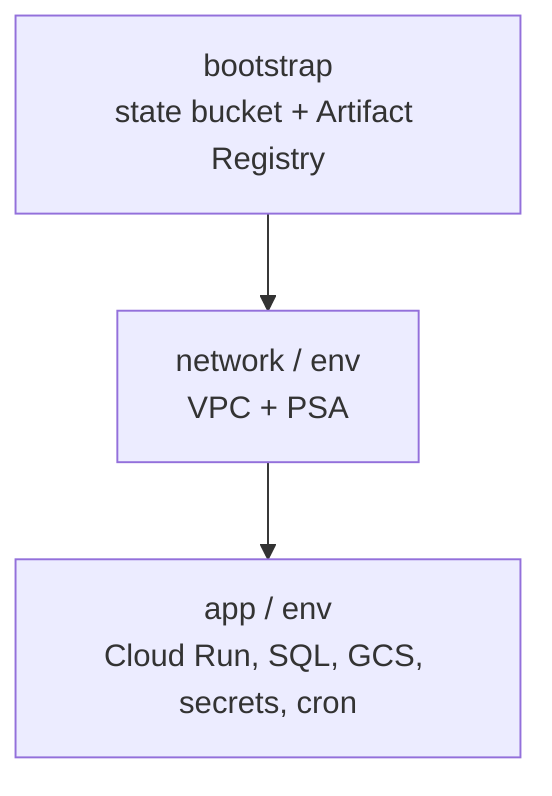

# GCP Deployment Guide (DriveeLink)

Infrastructure deployment for **DriveeLink** on Google Cloud: one GCP project, Terragrunt stacks, then Cloud Build onto Cloud Run.

Implementation repository: [TeckVeho/drivee-link-2](https://github.com/TeckVeho/drivee-link-2) (`develop`).

Paths below are relative to that repository.

| Topic | Path |
|-------|------|
| Layout and quick start | [`google_cloud/README.md`](https://github.com/TeckVeho/drivee-link-2/blob/develop/google_cloud/README.md) |
| Terraform layout | [`google_cloud/terraform/README.md`](https://github.com/TeckVeho/drivee-link-2/blob/develop/google_cloud/terraform/README.md) |
| SQL topology | [`google_cloud/terraform/SQL_TOPOLOGY.md`](https://github.com/TeckVeho/drivee-link-2/blob/develop/google_cloud/terraform/SQL_TOPOLOGY.md) |
| In-repo deploy notes | [`google_cloud/DEPLOY_GUIDE.md`](https://github.com/TeckVeho/drivee-link-2/blob/develop/google_cloud/DEPLOY_GUIDE.md) |

---

## Table of contents

1. [Architecture overview](#1-architecture-overview)
2. [Prerequisites](#2-prerequisites)
3. [Create the GCP project (manual)](#3-create-the-gcp-project-manual)
4. [Local login](#4-local-login)
5. [Terraform apply order](#5-terraform-apply-order)
6. [Configure `terraform.tfvars`](#6-configure-terraformtfvars)
7. [Terragrunt commands](#7-terragrunt-commands)
8. [After infra apply](#8-after-infra-apply)
9. [CI/CD](#9-cicd)
10. [Troubleshooting](#10-troubleshooting)

---

## 1. Architecture overview

All environments run in **one GCP project** `dx-driveelink`, region `asia-northeast1`. Dev, stg, and prod are separated by `env_suffix` and by Terraform state prefixes. Terraform does **not** create the GCP project.

| Stack | Role |
|-------|------|
| `bootstrap` | State bucket `dx-driveelink-terraform-state`, Artifact Registry `driveelink-docker`, Cloud Build source lifecycle |
| `network/{env}` | VPC + Private Service Access. CIDRs must not overlap |
| `app/{env}` | Cloud Run (API, web, migrate / queue / pdf jobs), Cloud SQL attach, GCS, Secret Manager, Cloud Scheduler |



| Terragrunt unit | State |
|-----------------|-------|
| `google_cloud/terraform/live/bootstrap` | local, in the bootstrap directory |
| `google_cloud/terraform/live/{env}/network` | `gs://dx-driveelink-terraform-state` prefix `network/{env}` |
| `google_cloud/terraform/live/{env}/app` | same bucket, prefix `app/{env}` |

Runtime after apply:

```text
Cloud Build → Artifact Registry (driveelink-docker) → Cloud Run → Cloud SQL (private IP, Direct VPC egress)
```

### Cloud SQL

| Env | Instance | Database | User | Who owns the instance |
|-----|----------|----------|------|------------------------|
| dev | `gcp-dev-sql-hub:asia-northeast1:dev-sql-hub` | `dx_driveelink_dev` | `driveelink_dev` | Hub project. This stack attaches only |
| stg | `dx-driveelink:asia-northeast1:dx-driveelink-prod` | `dx_driveelink_stg` | `driveelink_stg` | Prod stack. Stg creates its database and user |
| prod | `dx-driveelink-prod` | `dx_driveelink_prod` | `driveelink` | Prod stack |

Stg Cloud Run uses the **prod VPC**. Private IP is not transitive across VPCs. Dev Cloud Run uses the hub Shared VPC (`vpc_network_override` / `vpc_subnetwork_override`).

Do **not** set `enable_sql_night_weekend_schedule = true` on dev or stg. The check in `modules/app_compose/checks.tf` rejects a schedule unless this stack manages the instance. A schedule on the shared prod instance would stop production as well. Prod tfvars keep the schedule off.

### Default resource names

| Setting | Value |
|---------|--------|
| Project | `dx-driveelink` |
| State bucket | `dx-driveelink-terraform-state` |
| Artifact Registry | `asia-northeast1-docker.pkg.dev/dx-driveelink/driveelink-docker` |
| Cloud Run | `driveelink-api-{env}`, `driveelink-web-{env}` |
| Migrate / queue / pdf jobs | `driveelink-migrate-{env}`, `driveelink-queue-{env}`, `driveelink-pdf-{env}` |
| VPC | `driveelink-vpc-{env}`, subnet `driveelink-connector-{env}` |

Domains (Cloud Run domain mapping):

| Env | API | Web |
|-----|-----|-----|
| dev | `driveelink-api.vw-dev.com` | `driveelink.vw-dev.com` |
| stg | `v2-stage-api.driveelink.co.jp` | `v2-stage.driveelink.co.jp` |
| prod | `v2-api.driveelink.co.jp` | `v2.driveelink.co.jp` |

---

## 2. Prerequisites

| Tool | Notes |
|------|--------|
| [Terraform](https://developer.hashicorp.com/terraform/downloads) | `>= 1.5` |
| [Terragrunt](https://terragrunt.gruntwork.io/docs/getting-started/install/) | Orders `network` before `app` and writes the GCS backend |
| [Google Cloud SDK](https://cloud.google.com/sdk/docs/install) | `gcloud` |

The account that runs the first apply on `dx-driveelink` needs to create the state bucket and Artifact Registry, then Cloud Run, Cloud SQL, VPC, Secret Manager, and IAM bindings. Prod apply goes through review.

---

## 3. Create the GCP project (manual)

1. [Google Cloud Console](https://console.cloud.google.com/) → **Create Project**.
2. Project ID: `dx-driveelink`. This must match `project_id` in tfvars and `google_cloud/scripts/load-env.sh`.
3. Attach billing.

Cloud Build service account (Artifact Registry writer, set in bootstrap tfvars):

```bash
gcloud projects describe dx-driveelink --format='value(projectNumber)'
# serviceAccount:NUMBER@cloudbuild.gserviceaccount.com
```

Sample: [`environments/bootstrap/terraform.tfvars.example`](https://github.com/TeckVeho/drivee-link-2/blob/develop/google_cloud/terraform/environments/bootstrap/terraform.tfvars.example).

Each app stack can set the project label `tier` from `resource_tier`. Dev, stg, and prod share one project, so the last apply wins. Keep `resource_tier` the same across envs (`tier3` in the current examples) unless you move that resource to a single stack.

First import, once per app state that will apply:

```bash
cd google_cloud/terraform/live/dev/app
terragrunt import 'module.app_compose.module.iam.google_project.wiki_labels' dx-driveelink
```

Repeat for `stg` and `prod` if those states also manage the project.

---

## 4. Local login

The Google provider uses Application Default Credentials. CLI login and ADC are separate.

```bash
gcloud auth login
gcloud auth application-default login
gcloud config set project dx-driveelink
gcloud auth application-default print-access-token >/dev/null && echo "ADC OK"
```

`project_id` in `terraform.tfvars` is what Terraform uses. `gcloud config` only affects manual `gcloud` commands. If plan fails with a credential error, run `gcloud auth application-default login` again.

Service-account impersonation, only when `roles/iam.serviceAccountTokenCreator` is granted:

```bash
export GOOGLE_IMPERSONATE_SERVICE_ACCOUNT=terraform@dx-driveelink.iam.gserviceaccount.com
gcloud auth application-default login --impersonate-service-account="$GOOGLE_IMPERSONATE_SERVICE_ACCOUNT"
```

---

## 5. Terraform apply order

| Step | Stack | Depends on |
|------|-------|------------|
| 1 | `live/bootstrap` | Project `dx-driveelink` exists |
| 2 | `live/prod/network` then `live/prod/app` | Bootstrap bucket. Prod owns the shared SQL instance and the VPC that stg uses |
| 3 | `live/stg/app` | Prod network state and prod SQL instance. Stg is attach-only |
| 4 | `live/dev/app` | Hub Shared VPC already attached. Local `live/dev/network` is optional while `vpc_*_override` points at the hub |
| 5 | Cloud Build | Artifact Registry and the app stack exist |

`enable_cloud_sql = true` requires the VPC this env actually uses:

- prod: `network_remote_state_prefix = "network/prod"`
- stg: `network_remote_state_prefix = "network/prod"` (same VPC as the SQL private IP)
- dev: `vpc_network_override` / `vpc_subnetwork_override` into `gcp-dev-sql-hub`

---

## 6. Configure `terraform.tfvars`

`terraform.tfvars` is gitignored. Copy the example, then edit.

```bash
cp google_cloud/terraform/environments/bootstrap/terraform.tfvars.example \
   google_cloud/terraform/environments/bootstrap/terraform.tfvars
cp google_cloud/terraform/environments/prod/network/terraform.tfvars.example \
   google_cloud/terraform/environments/prod/network/terraform.tfvars
cp google_cloud/terraform/environments/prod/app/terraform.tfvars.example \
   google_cloud/terraform/environments/prod/app/terraform.tfvars
```

Same pattern for `dev` and `stg` under `google_cloud/terraform/environments/{env}/`.

### 6.1 Bootstrap

| Variable | Value |
|----------|--------|
| `project_id` | `dx-driveelink` |
| `state_bucket_name` | `dx-driveelink-terraform-state` |
| `artifact_repo_id` | `driveelink-docker` |
| `additional_artifact_registry_writer_members` | Cloud Build SA that pushes images |

### 6.2 Network

`project_id` is `dx-driveelink`. `env_suffix` is `dev`, `stg`, or `prod`. `connector_subnet_cidr` and `private_service_peering_cidr` must differ per env. Defaults in the network module: dev `10.8.0.0/24` + PSA `10.247.0.0`, stg `10.9.0.0/24` + `10.248.0.0`, prod `10.10.0.0/24` + `10.249.0.0`.

### 6.3 App

Examples:

- [dev](https://github.com/TeckVeho/drivee-link-2/blob/develop/google_cloud/terraform/environments/dev/app/terraform.tfvars.example)
- [stg](https://github.com/TeckVeho/drivee-link-2/blob/develop/google_cloud/terraform/environments/stg/app/terraform.tfvars.example)
- [prod](https://github.com/TeckVeho/drivee-link-2/blob/develop/google_cloud/terraform/environments/prod/app/terraform.tfvars.example)

Images:

```text
asia-northeast1-docker.pkg.dev/dx-driveelink/driveelink-docker/driveelink-api:{dev|stg|prod}
asia-northeast1-docker.pkg.dev/dx-driveelink/driveelink-docker/driveelink-web:{dev|stg|prod}
```

Put non-secret config in `env_vars` (`MAIL_FROM_ADDRESS`, `MAIL_FROM_NAME`). Secret values stay in Secret Manager (§6.5).

### 6.4 Cloud SQL flags

| Variable | dev | stg | prod |
|----------|-----|-----|------|
| `cloud_sql_manage_instance` | `false` | `false` | `true` |
| `cloud_sql_manage_database` | `true` | `true` | `true` |
| `enable_sql_night_weekend_schedule` | `false` | `false` | `false` |
| `sql_deletion_protection` | n/a (no local instance) | n/a | `true` |
| `sql_backup_enabled` | n/a | n/a | forced `true` when `env_suffix = "prod"` |
| `sql_backup_start_time` | — | — | `17:00` UTC. Prod plan fails if this is overridden |
| `sql_point_in_time_recovery_enabled` | `false` | `false` | `false` in the current example |

Prod backup and the `17:00` window are enforced in [`modules/app_compose/data.tf`](https://github.com/TeckVeho/drivee-link-2/blob/develop/google_cloud/terraform/modules/app_compose/data.tf) and [`checks.tf`](https://github.com/TeckVeho/drivee-link-2/blob/develop/google_cloud/terraform/modules/app_compose/checks.tf). Point-in-time recovery stays off unless `sql_point_in_time_recovery_enabled` is set. The instance also sets `deletion_protection_enabled` in the Cloud SQL module when prod creates it.

### 6.5 Secrets

Every API key, password, and connection string for Cloud Run lives in Secret Manager on `dx-driveelink`. Do not put secret values in tfvars, `env_vars`, git, or Cloud Build substitutions.

| Secret | Who writes the value | How Cloud Run gets it |
|--------|----------------------|------------------------|
| `driveelink-database-url-{env}` | Terraform, when `cloud_sql_manage_database = true` | Mounted as `db.env` on API, migrate, queue, and pdf jobs |
| `driveelink-app-secrets-{env}` | Ops, via the scripts below | Mounted as `/secrets/app.env` when `app_secrets_bundle_secret_id` is set |

Bundle keys (sensitive only):

```env
JWT_SECRET=...
OPENAI_API_KEY=...
AWS_SES_ACCESS_KEY_ID=...
AWS_SES_SECRET_ACCESS_KEY=...
```

`DATABASE_URL` is not part of the bundle. `MAIL_FROM_ADDRESS` and `MAIL_FROM_NAME` stay in `env_vars`.

```bash
bash google_cloud/scripts/gcp/create-app-secrets-bundle.sh dev \
  --project dx-driveelink \
  --data-file /path/to/app-secrets.dev.env

bash google_cloud/scripts/gcp/migrate-app-secrets-to-bundle.sh dev
```

Rotate by adding a version. The mount uses `latest`, so no Terraform apply is required:

```bash
gcloud secrets versions add driveelink-app-secrets-dev \
  --project=dx-driveelink \
  --data-file=/path/to/app-secrets.dev.env
```

Wire-up in tfvars:

```hcl
app_secrets_bundle_secret_id = "driveelink-app-secrets-dev"
api_secret_env_from_sm       = []
```

Cloud Run runtime SA receives `roles/secretmanager.secretAccessor` from [`modules/secrets`](https://github.com/TeckVeho/drivee-link-2/blob/develop/google_cloud/terraform/modules/secrets).

### 6.6 Schedulers

Cloud Scheduler calls the API with OIDC. Service account id: `driveelink-cron-api-{env}` (30-character limit). Module: [`modules/app_cron`](https://github.com/TeckVeho/drivee-link-2/blob/develop/google_cloud/terraform/modules/app_cron).

| Flag | Job | Default cron (`Asia/Tokyo`) | Endpoint |
|------|-----|-----------------------------|----------|
| `enable_hr_visa_expire_scheduler` | `driveelink2-hr-visa-expire-reminder-{env}` | `0 10 1 * *` | `POST /api/scheduler/hr-visa-expire-reminder` |
| `enable_hr_recalc_scheduler` | `driveelink2-hr-recalc-{env}` | `0 9 * * *` | `POST /api/scheduler/recalculate` |
| `enable_hr_status_yearly_snapshot_scheduler` | `driveelink2-hr-status-yearly-snapshot-{env}` | dev/stg `0 9 1 1 *`, prod `0 1 1 1 *` | `POST /api/scheduler/freeze-hr-status-yearly-snapshot` |

Current app examples enable all three on dev, stg, and prod.

---

## 7. Terragrunt commands

Entry point: [`google_cloud/terraform/live`](https://github.com/TeckVeho/drivee-link-2/blob/develop/google_cloud/terraform/live/README.md).

```bash
cd google_cloud/terraform/live/bootstrap
terragrunt init
terragrunt plan
terragrunt apply

cd ../prod/network
terragrunt init -reconfigure
terragrunt apply

cd ../app
terragrunt apply
```

Then `live/stg/app` and `live/dev/app`.

| Command | Effect |
|---------|--------|
| `init` / `init -reconfigure` | Providers and GCS backend. Use `-reconfigure` when the bucket or prefix changes |
| `plan` | Diff only |
| `apply` | Change GCP and state |
| `output` | URLs, connection name, migrate job name |
| `import` | Adopt an existing resource (project labels, domain mappings, scheduler jobs) |

`run-all plan` from `live/` previews every unit. Cache lives under `live/**/.terragrunt-cache/` and is gitignored.

---

## 8. After infra apply

### 8.1 Images

```bash
gcloud auth configure-docker asia-northeast1-docker.pkg.dev
gcloud builds submit --project=dx-driveelink \
  --config=google_cloud/cloudbuild/cloudbuild.dev.yaml
```

Stg and prod configs: `cloudbuild.stg.yaml`, `cloudbuild.prod.yaml`. API-only and web-only variants: `cloudbuild.{env}.api.yaml`, `cloudbuild.{env}.web.yaml`.

Cloud Build updates the Cloud Run service and job images, then runs `driveelink-migrate-{env}` unless `_SKIP_MIGRATE=true`. Queue and pdf job image updates are in `google_cloud/scripts/gcp/deploy-queue-cloud-run-job.sh` and `deploy-pdf-cloud-run-job.sh`.

### 8.2 Migrate job

```bash
export PROJECT_ID=dx-driveelink
export MIGRATE_JOB_NAME=driveelink-migrate-dev
bash google_cloud/scripts/run-migrate-job.sh
```

Or from the app stack: `terragrunt output -raw cloud_run_migrate_job_name`.

### 8.3 Domains and public URL env

```bash
cd google_cloud/terraform/live/dev/app
terragrunt output
bash google_cloud/scripts/gcp/map-dev-domain-mappings.sh --skip-terraform
```

Stg: `map-stg-domain-mappings.sh`. Prod: `map-prod-domain-mappings.sh`. `api_custom_domain` and `web_custom_domain` in tfvars set `API_URL`, `FRONTEND_URL`, `CORS_ORIGINS`, and the web `NEXT_PUBLIC_*` values. Import the mappings into state after a manual `gcloud` mapping; the import addresses are in [`google_cloud/README.md`](https://github.com/TeckVeho/drivee-link-2/blob/develop/google_cloud/README.md).

---

## 9. CI/CD

| Piece | Where |
|-------|--------|
| Deploy workflow | [`.github/workflows/cd-gcp-drivee.yml`](https://github.com/TeckVeho/drivee-link-2/blob/develop/.github/workflows/cd-gcp-drivee.yml) |
| Workload Identity Federation | [`google_cloud/cloudbuild/GITHUB_ACTIONS_WIF.md`](https://github.com/TeckVeho/drivee-link-2/blob/develop/google_cloud/cloudbuild/GITHUB_ACTIONS_WIF.md) |
| Cloud Build configs | [`google_cloud/cloudbuild/README.md`](https://github.com/TeckVeho/drivee-link-2/blob/develop/google_cloud/cloudbuild/README.md) |

The workflow runs on push to `develop`, `staging`, and `production` when `backend-express/**`, `frontend/**`, or `google_cloud/**` changes. GitHub Environment name equals the branch name. Auth uses `GCP_WORKLOAD_IDENTITY_PROVIDER` and `GCP_SERVICE_ACCOUNT` (no JSON key on the runner).

`_CLOUDSQL_INSTANCE` in the Cloud Build YAML must match the live instance (`dev-sql-hub` or `dx-driveelink-prod`). A stale substitution overwrites the Cloud SQL attachment on the service.

---

## 10. Troubleshooting

| Symptom | What to do |
|---------|------------|
| `403` or entity not found on plan | Refresh ADC. Confirm `project_id` is `dx-driveelink` and the account has IAM there |
| App plan cannot read network state | Apply the network stack this env uses. Stg reads `network/prod`, not `network/stg` |
| `enable_sql_night_weekend_schedule` check fails | Leave it `false` on hub and shared instances |
| Prod plan fails on backup start time | Remove `sql_backup_start_time` or set it to `17:00` |
| Cloud Run image not found | Build and push to `driveelink-docker` first |
| API exits on startup | Bundle `driveelink-app-secrets-{env}` has `JWT_SECRET`. `driveelink-database-url-{env}` exists. Runtime SA has `secretAccessor` |
| Secret permission denied | Re-apply the app stack after setting `app_secrets_bundle_secret_id` |
| Migrate or queue job missing | `terragrunt apply` the app stack before Cloud Build. Build logs a warning and skips a missing job |
| State lock | Wait for the other apply. `force-unlock` only when nothing is writing state |

---

## Checklists

**First environment**

- [ ] Project `dx-driveelink` exists and billing is on
- [ ] `terragrunt apply` bootstrap, then the network this env uses, then `app`
- [ ] Cloud Build SA can push to `driveelink-docker`
- [ ] `driveelink-database-url-{env}` exists after app apply
- [ ] Bundle `driveelink-app-secrets-{env}` created and `app_secrets_bundle_secret_id` set, then app re-applied
- [ ] Images built, migrate job succeeded, API health checked
- [ ] `enable_sql_night_weekend_schedule = false`

**Production**

- [ ] `live/prod/network` applied before `live/prod/app`
- [ ] `sql_deletion_protection = true`
- [ ] Backup enabled (module forces this for `env_suffix = prod`) and start time `17:00` UTC
- [ ] Night/weekend SQL schedule off
- [ ] Stg still uses user `driveelink_stg` and database `dx_driveelink_stg` on the same instance
- [ ] Apply reviewed before it runs
