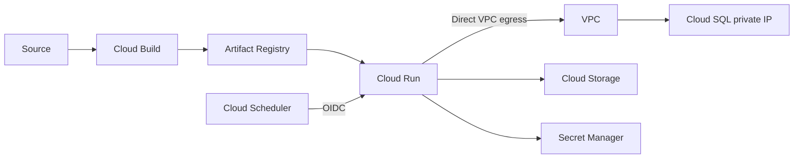
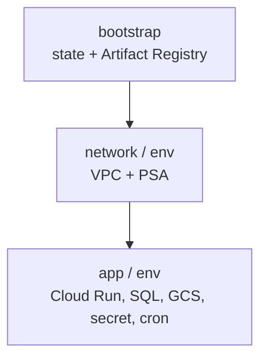

# GCP インフラ

> **Language**: [🇻🇳 Tiếng Việt](gcp-infra.vi.md) | [🇯🇵 日本語](gcp-infra.ja.md)

アプリケーションを Google Cloud に載せるときの知識と構成をまとめる。末尾のデプロイ順は [TeckVeho/drivee-link-2](https://github.com/TeckVeho/drivee-link-2)（ブランチ `develop`）を例にする。英語版は後で追加する。

## 目次

1. [概要](#概要)
2. [構成](#構成)
3. [例: DriveeLink](#例-driveelink)

## 概要

アプリケーションは **Cloud Run** で動かす。Compute Engine の仮想マシンは使わない。ビルド、イメージの保管、実行は分ける。

| コンポーネント | 役割 |
|----------------|------|
| Cloud Build | ソースからイメージをビルドする |
| Artifact Registry | Docker イメージを保管する |
| Cloud Run | API、Web、ジョブ（migrate、キュー、バックグラウンド処理）を動かす |
| VPC + Direct VPC egress | Cloud Run からプライベート資源への経路。Serverless VPC Access connector は使わない |
| Cloud SQL | データベース。プライベート IP のみ、SSL を有効にする |
| Cloud Storage | アップロードファイル |
| Secret Manager | パスワード、API キー、接続文字列 |
| Cloud Scheduler | OIDC 付き HTTP をスケジュール実行する。Cron は Cloud Run のプロセス内では動かさない |

`dev`、`stg`、`prod` はリソース名の接尾辞と Terraform state の prefix で分ける。一つの GCP プロジェクトにまとめてよい。Terraform はプロジェクトを作らない。プロジェクトと課金は先に Console で作る。

IaC は三つの stack に分け、依存の順に apply する。

| Stack | 内容 | いつ apply するか |
|-------|------|-------------------|
| `bootstrap` | state バケットと Artifact Registry | プロジェクトにつき一度 |
| `network/{env}` | VPC と Private Service Access の範囲。同一プロジェクト内の CIDR は重ねない | その VPC を使う app stack の前 |
| `app/{env}` | Cloud Run、SQL の接続、バケット、secret、scheduler | network の後（その環境が実際に使う VPC の後） |

Terraform がリソースを作り、維持する。Cloud Build は動いているイメージの更新と migrate ジョブの起動だけを行う。秘密の値は Terraform にも git にも Cloud Run の通常の環境変数にも置かない。Terraform は secret の読み取り権限を付ける。値は運用が Secret Manager に書く。

Cloud Run から Cloud SQL へはプライベート IP 上のソケットでつなぐ。サービスとデータベースは同じ VPC にいる必要がある。プライベート IP は別の VPC を越えて届かない。Cloud Run は、接続先インスタンスがある VPC へ egress する。

本番は自動バックアップを有効にし、インスタンスの削除を防ぐ。

## 構成





`bootstrap` の state は bootstrap ディレクトリのローカルに置く。`network` と `app` の state は GCS バケットにあり、環境ごとに prefix を分ける（`network/{env}`、`app/{env}`）。一つの環境を消してもプロジェクトの API は無効にしない。ほかの環境が同じ API を使っている。

| 層 | Terraform が持つもの | Cloud Build / 運用が持つもの |
|----|----------------------|------------------------------|
| インフラ | Service、job、VPC、SQL インスタンス、IAM、secret のマウント | — |
| イメージ | 最初に宣言したイメージ名 | ビルドごとの新しいタグ |
| 秘密 | 空の secret、または SQL モジュールが作る secret と `secretAccessor` | API キーとアプリのパスワード |
| スケジュール | Scheduler ジョブと OIDC 用サービスアカウント | — |

稼働後の経路:

```text
ユーザー → Cloud Run（API / Web）
Cloud Run → Secret Manager（設定を読む）
Cloud Run → Cloud SQL（プライベート IP、同じ VPC）
Cloud Scheduler → Cloud Run（OIDC、内部エンドポイント）
```

この図が成り立つ条件:

- 同一プロジェクト内の VPC で、サブネット CIDR と PSA 範囲が重ならない。
- Cloud SQL のパブリック IP は無効。`ssl_mode` は `ENCRYPTED_ONLY`。
- SQL とプライベート範囲だけに届ければよいとき、Cloud Run の egress は `PRIVATE_RANGES_ONLY`。
- 複数環境が一つのインスタンスを共有するときは、環境ごとに SQL ユーザーを分ける。
- 本番のバックアップは有効にする。ポイントインタイムリカバリは任意で、バイナリログが必要。

## 例: DriveeLink

リポジトリ: [TeckVeho/drivee-link-2](https://github.com/TeckVeho/drivee-link-2)、ブランチ `develop`。

| 内容 | パス |
|------|------|
| 構成 | [`google_cloud/README.md`](https://github.com/TeckVeho/drivee-link-2/blob/develop/google_cloud/README.md) |
| Terraform | [`google_cloud/terraform/README.md`](https://github.com/TeckVeho/drivee-link-2/blob/develop/google_cloud/terraform/README.md) |
| SQL トポロジ | [`google_cloud/terraform/SQL_TOPOLOGY.md`](https://github.com/TeckVeho/drivee-link-2/blob/develop/google_cloud/terraform/SQL_TOPOLOGY.md) |

DriveeLink は上の構成を、一つのプロジェクト `dx-driveelink`、リージョン `asia-northeast1` で使っている。

| 項目 | 値 |
|------|-----|
| state バケット | `dx-driveelink-terraform-state` |
| Artifact Registry | `asia-northeast1-docker.pkg.dev/dx-driveelink/driveelink-docker` |
| Cloud Run | `driveelink-api-{env}`、`driveelink-web-{env}` |
| ジョブ | `driveelink-migrate-{env}`、`driveelink-queue-{env}`、`driveelink-pdf-{env}` |

**ネットワークと SQL。** dev は SQL hub `gcp-dev-sql-hub` へ、hub の Shared VPC 経由で接続する。stg と prod は hub とは別の一つのネットワークを使い、一つの Cloud SQL インスタンスを共有する。インスタンス上のデータベースとユーザーは環境ごとに分ける。

| 環境 | ネットワーク | インスタンス | データベース | ユーザー |
|------|--------------|--------------|--------------|----------|
| dev | hub の Shared VPC | `gcp-dev-sql-hub:asia-northeast1:dev-sql-hub` | `dx_driveelink_dev` | `driveelink_dev` |
| stg | stg/prod 共通ネットワーク（`driveelink-vpc-prod`） | `dx-driveelink-prod` | `dx_driveelink_stg` | `driveelink_stg` |
| prod | stg/prod 共通ネットワーク（`driveelink-vpc-prod`） | `dx-driveelink-prod` | `dx_driveelink_prod` | `driveelink` |

共有インスタンスの所有者は prod である。バックアップは強制的に有効で、開始時刻は `17:00` UTC。ポイントインタイムリカバリは現在オフ。

### デプロイ順

共通のネットワークとインスタンスは prod の stack が作る。そのため prod を stg より先に apply する。dev は hub に接続し、stg/prod のネットワークは使わない。

| 手順 | Stack | 条件 |
|------|-------|------|
| 1 | `google_cloud/terraform/live/bootstrap` | プロジェクト `dx-driveelink` に課金がある |
| 2 | `live/prod/network` のあと `live/prod/app` | state バケットがある。prod が stg/prod 共通ネットワークと共有 SQL インスタンスを作る |
| 3 | `live/stg/app` | 同じ state `network/prod` と同じインスタンス。stg は自分のデータベースとユーザーだけを作る |
| 4 | `live/dev/app` | hub がこのプロジェクトを Shared VPC に参加させている。dev は stg/prod のネットワークを apply しない |
| 5 | Cloud Build | レジストリと Cloud Run サービスがある |

```bash
cd google_cloud/terraform/live/bootstrap
terragrunt init && terragrunt apply

cd ../prod/network
terragrunt init -reconfigure && terragrunt apply

cd ../app
terragrunt apply
```

その後に `live/stg/app` と `live/dev/app` を apply する。`terraform.tfvars` は `google_cloud/terraform/environments/` の `*.example` からコピーし、コミットしない。

app が読む state の prefix:

- stg と prod: `network/prod`（一つの共通ネットワーク）
- dev: SQL hub の VPC。stg/prod のネットワークは読まない

イメージ:

```text
asia-northeast1-docker.pkg.dev/dx-driveelink/driveelink-docker/driveelink-api:{dev|stg|prod}
asia-northeast1-docker.pkg.dev/dx-driveelink/driveelink-docker/driveelink-web:{dev|stg|prod}
```

```bash
gcloud builds submit --project=dx-driveelink \
  --config=google_cloud/cloudbuild/cloudbuild.dev.yaml
```

stg と prod は `cloudbuild.stg.yaml` と `cloudbuild.prod.yaml` を使う。ビルドはイメージを更新したあと `driveelink-migrate-{env}` を実行する。`_SKIP_MIGRATE=true` のときは実行しない。

Secret:

| Secret | 値を書く人 |
|--------|------------|
| `driveelink-database-url-{env}` | Terraform。stack がそのデータベースを管理するとき |
| `driveelink-app-secrets-{env}` | 運用。`/secrets/app.env` としてマウントする |

```bash
bash google_cloud/scripts/gcp/create-app-secrets-bundle.sh dev \
  --project dx-driveelink \
  --data-file /path/to/app-secrets.dev.env
```

Scheduler（OIDC、サービスアカウント `driveelink-cron-api-{env}`）:

| ジョブ | Cron（`Asia/Tokyo`） | エンドポイント |
|--------|----------------------|----------------|
| `driveelink2-hr-visa-expire-reminder-{env}` | `0 10 1 * *` | `POST /api/scheduler/hr-visa-expire-reminder` |
| `driveelink2-hr-recalc-{env}` | `0 9 * * *` | `POST /api/scheduler/recalculate` |
| `driveelink2-hr-status-yearly-snapshot-{env}` | dev/stg は `0 9 1 1 *`、prod は `0 1 1 1 *` | `POST /api/scheduler/freeze-hr-status-yearly-snapshot` |

CI: [`.github/workflows/cd-gcp-drivee.yml`](https://github.com/TeckVeho/drivee-link-2/blob/develop/.github/workflows/cd-gcp-drivee.yml) は、backend、frontend、または `google_cloud/**` が変わったとき、ブランチ `develop`、`staging`、`production` で動く。認証は Workload Identity Federation。説明は [`google_cloud/cloudbuild/GITHUB_ACTIONS_WIF.md`](https://github.com/TeckVeho/drivee-link-2/blob/develop/google_cloud/cloudbuild/GITHUB_ACTIONS_WIF.md)。YAML の `_CLOUDSQL_INSTANCE` は稼働中のインスタンスと一致させる。古い値はサービスの SQL 接続を上書きする。

ドメイン:

| 環境 | API | Web |
|------|-----|-----|
| dev | `driveelink-api.vw-dev.com` | `driveelink.vw-dev.com` |
| stg | `v2-stage-api.driveelink.co.jp` | `v2-stage.driveelink.co.jp` |
| prod | `v2-api.driveelink.co.jp` | `v2.driveelink.co.jp` |

ドメイン割り当てスクリプトと state の import コマンドは [`google_cloud/README.md`](https://github.com/TeckVeho/drivee-link-2/blob/develop/google_cloud/README.md) にある。
