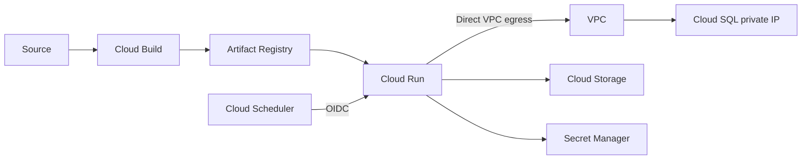
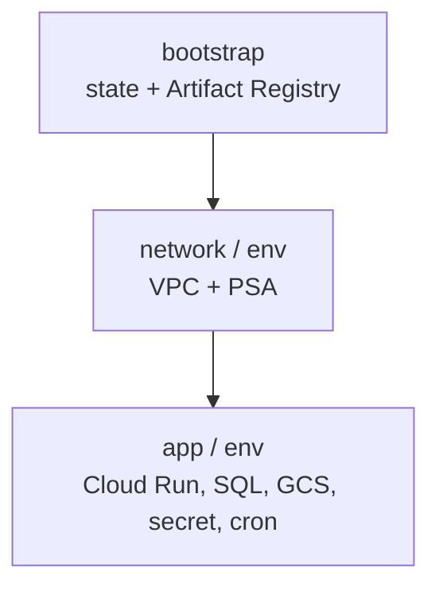

# Hạ tầng GCP

Tài liệu này tóm tắt kiến thức và kiến trúc triển khai ứng dụng lên Google Cloud. Phần cuối lấy [TeckVeho/drivee-link-2](https://github.com/TeckVeho/drivee-link-2) (nhánh `develop`) làm ví dụ cho thứ tự triển khai. Bản tiếng Anh và tiếng Nhật sẽ thêm sau khi bản này được chốt.

## Mục lục

1. [Tóm tắt](#tóm-tắt)
2. [Kiến trúc](#kiến-trúc)
3. [Ví dụ: DriveeLink](#ví-dụ-driveelink)

## Tóm tắt

Ứng dụng chạy trên **Cloud Run**. Không dùng máy ảo Compute Engine. Build, lưu image và chạy là ba việc tách nhau.

| Thành phần | Vai trò |
|------------|---------|
| Cloud Build | Build image từ source |
| Artifact Registry | Giữ image Docker |
| Cloud Run | Chạy API, web và job (migrate, hàng đợi, tác vụ nền) |
| VPC + Direct VPC egress | Đường riêng từ Cloud Run tới tài nguyên private. Không dùng Serverless VPC Access connector |
| Cloud SQL | Database, chỉ private IP, bật SSL |
| Cloud Storage | File upload |
| Secret Manager | Mật khẩu, API key, chuỗi kết nối |
| Cloud Scheduler | Gọi HTTP có OIDC theo lịch. Cron không chạy trong process của Cloud Run |

Ba môi trường `dev`, `stg`, `prod` tách bằng hậu tố tên và bằng prefix state Terraform. Có thể đặt chung một GCP project. Terraform không tạo project. Project và billing tạo tay trên Console trước.

IaC chia ba stack, apply theo thứ tự phụ thuộc:

| Stack | Việc làm | Apply khi nào |
|-------|----------|----------------|
| `bootstrap` | Bucket state và Artifact Registry | Một lần cho project |
| `network/{env}` | VPC và dải Private Service Access. CIDR mỗi môi trường không trùng | Trước stack app của môi trường dùng VPC đó |
| `app/{env}` | Cloud Run, gắn SQL, bucket, secret, scheduler | Sau network (hoặc sau VPC mà môi trường đó thực sự dùng) |

Terraform tạo và giữ resource. Cloud Build chỉ đổi image đang chạy và kích hoạt job migrate. Giá trị bí mật không vào Terraform, không vào git, không vào biến thường của Cloud Run. Terraform cấp quyền đọc secret. Người vận hành ghi giá trị vào Secret Manager.

Cloud Run tới Cloud SQL bằng socket trên private IP. Service và database phải cùng VPC. Private IP không đi xuyên qua VPC khác. Vì vậy Cloud Run phải egress vào đúng VPC của instance mà nó gắn.

Production bật backup tự động và chặn xóa instance.

## Kiến trúc





State của `bootstrap` để local trong thư mục bootstrap. State `network` và `app` nằm trên bucket GCS, mỗi môi trường một prefix (`network/{env}`, `app/{env}`). Xóa một môi trường không được tắt API của project, vì các môi trường kia còn dùng.

| Lớp | Terraform giữ | Cloud Build / vận hành giữ |
|-----|----------------|------------------------------|
| Hạ tầng | Service, job, VPC, instance SQL, IAM, mount secret | — |
| Image | Tên image khai báo ban đầu | Tag mới mỗi lần build |
| Bí mật | Secret rỗng hoặc secret do module SQL tạo, cộng quyền `secretAccessor` | Nội dung API key và mật khẩu ứng dụng |
| Lịch | Job Scheduler và service account OIDC | — |

Đường request sau khi đã chạy:

```text
Người dùng → Cloud Run (API / web)
Cloud Run → Secret Manager (đọc cấu hình)
Cloud Run → Cloud SQL (private IP, cùng VPC)
Cloud Scheduler → Cloud Run (OIDC, đúng endpoint nội bộ)
```

Điều kiện để sơ đồ này đứng:

- CIDR subnet và dải PSA khác nhau giữa các VPC trong cùng project.
- Cloud SQL tắt IP public, `ssl_mode` là `ENCRYPTED_ONLY`.
- Egress của Cloud Run là `PRIVATE_RANGES_ONLY` khi chỉ cần tới SQL và dải private.
- User SQL của từng môi trường khác nhau nếu nhiều môi trường gắn một instance.
- Backup production bật. Point-in-time recovery là tùy chọn, cần binary log.

## Ví dụ: DriveeLink

Repo: [TeckVeho/drivee-link-2](https://github.com/TeckVeho/drivee-link-2), nhánh `develop`.

| Nội dung | Đường dẫn |
|----------|-----------|
| Bố cục | [`google_cloud/README.md`](https://github.com/TeckVeho/drivee-link-2/blob/develop/google_cloud/README.md) |
| Terraform | [`google_cloud/terraform/README.md`](https://github.com/TeckVeho/drivee-link-2/blob/develop/google_cloud/terraform/README.md) |
| Topology SQL | [`google_cloud/terraform/SQL_TOPOLOGY.md`](https://github.com/TeckVeho/drivee-link-2/blob/develop/google_cloud/terraform/SQL_TOPOLOGY.md) |

DriveeLink dùng đúng kiến trúc ở trên, trong một project `dx-driveelink`, region `asia-northeast1`.

| Hạng mục | Giá trị |
|----------|---------|
| Bucket state | `dx-driveelink-terraform-state` |
| Artifact Registry | `asia-northeast1-docker.pkg.dev/dx-driveelink/driveelink-docker` |
| Cloud Run | `driveelink-api-{env}`, `driveelink-web-{env}` |
| Job | `driveelink-migrate-{env}`, `driveelink-queue-{env}`, `driveelink-pdf-{env}` |
**Mạng và SQL.** Dev đi tới SQL hub `gcp-dev-sql-hub` qua Shared VPC của hub. Stg và prod dùng một mạng riêng, tách khỏi hub, và dùng chung một Cloud SQL instance. Trên instance đó mỗi môi trường có database và user riêng.

| Môi trường | Mạng | Instance | Database | User |
|------------|------|----------|----------|------|
| dev | Shared VPC của hub | `gcp-dev-sql-hub:asia-northeast1:dev-sql-hub` | `dx_driveelink_dev` | `driveelink_dev` |
| stg | Mạng chung stg/prod (`driveelink-vpc-prod`) | `dx-driveelink-prod` | `dx_driveelink_stg` | `driveelink_stg` |
| prod | Mạng chung stg/prod (`driveelink-vpc-prod`) | `dx-driveelink-prod` | `dx_driveelink_prod` | `driveelink` |

Prod sở hữu instance chung. Backup được ép bật, cửa sổ `17:00` UTC. Point-in-time recovery đang tắt.

### Thứ tự triển khai

Mạng và instance dùng chung do stack prod tạo, nên apply prod trước stg. Dev gắn hub, không dùng mạng của stg/prod.

| Bước | Stack | Điều kiện |
|------|-------|-----------|
| 1 | `google_cloud/terraform/live/bootstrap` | Project `dx-driveelink` đã có billing |
| 2 | `live/prod/network` rồi `live/prod/app` | Bucket state đã có. Prod tạo mạng chung stg/prod và instance SQL dùng chung |
| 3 | `live/stg/app` | Cùng state `network/prod` và cùng instance. Stg chỉ tạo database và user của mình |
| 4 | `live/dev/app` | Hub đã gắn project này vào Shared VPC. Dev không apply mạng stg/prod |
| 5 | Cloud Build | Registry và service Cloud Run đã có |

```bash
cd google_cloud/terraform/live/bootstrap
terragrunt init && terragrunt apply

cd ../prod/network
terragrunt init -reconfigure && terragrunt apply

cd ../app
terragrunt apply
```

Sau đó `live/stg/app` và `live/dev/app`. `terraform.tfvars` copy từ file `*.example` trong `google_cloud/terraform/environments/` và không commit.

Prefix state mà app đọc:

- stg và prod: `network/prod` (một mạng chung)
- dev: VPC của SQL hub, không đọc mạng stg/prod

Image:

```text
asia-northeast1-docker.pkg.dev/dx-driveelink/driveelink-docker/driveelink-api:{dev|stg|prod}
asia-northeast1-docker.pkg.dev/dx-driveelink/driveelink-docker/driveelink-web:{dev|stg|prod}
```

```bash
gcloud builds submit --project=dx-driveelink \
  --config=google_cloud/cloudbuild/cloudbuild.dev.yaml
```

Stg và prod dùng `cloudbuild.stg.yaml`, `cloudbuild.prod.yaml`. Build cập nhật image rồi chạy `driveelink-migrate-{env}`, trừ khi `_SKIP_MIGRATE=true`.

Secret:

| Secret | Ai ghi giá trị |
|--------|----------------|
| `driveelink-database-url-{env}` | Terraform, khi stack quản lý database |
| `driveelink-app-secrets-{env}` | Vận hành, mount thành `/secrets/app.env` |

```bash
bash google_cloud/scripts/gcp/create-app-secrets-bundle.sh dev \
  --project dx-driveelink \
  --data-file /path/to/app-secrets.dev.env
```

Scheduler (OIDC, service account `driveelink-cron-api-{env}`):

| Job | Cron (`Asia/Tokyo`) | Endpoint |
|-----|---------------------|----------|
| `driveelink2-hr-visa-expire-reminder-{env}` | `0 10 1 * *` | `POST /api/scheduler/hr-visa-expire-reminder` |
| `driveelink2-hr-recalc-{env}` | `0 9 * * *` | `POST /api/scheduler/recalculate` |
| `driveelink2-hr-status-yearly-snapshot-{env}` | dev/stg `0 9 1 1 *`, prod `0 1 1 1 *` | `POST /api/scheduler/freeze-hr-status-yearly-snapshot` |

CI: [`.github/workflows/cd-gcp-drivee.yml`](https://github.com/TeckVeho/drivee-link-2/blob/develop/.github/workflows/cd-gcp-drivee.yml) chạy trên nhánh `develop`, `staging`, `production` khi đổi backend, frontend hoặc `google_cloud/**`. Auth bằng Workload Identity Federation, mô tả ở [`google_cloud/cloudbuild/GITHUB_ACTIONS_WIF.md`](https://github.com/TeckVeho/drivee-link-2/blob/develop/google_cloud/cloudbuild/GITHUB_ACTIONS_WIF.md). Biến `_CLOUDSQL_INSTANCE` trong YAML phải khớp instance đang chạy. Giá trị cũ sẽ ghi đè phần gắn SQL trên service.

Domain:

| Môi trường | API | Web |
|------------|-----|-----|
| dev | `driveelink-api.vw-dev.com` | `driveelink.vw-dev.com` |
| stg | `v2-stage-api.driveelink.co.jp` | `v2-stage.driveelink.co.jp` |
| prod | `v2-api.driveelink.co.jp` | `v2.driveelink.co.jp` |

Script map domain và lệnh import state nằm trong [`google_cloud/README.md`](https://github.com/TeckVeho/drivee-link-2/blob/develop/google_cloud/README.md).
