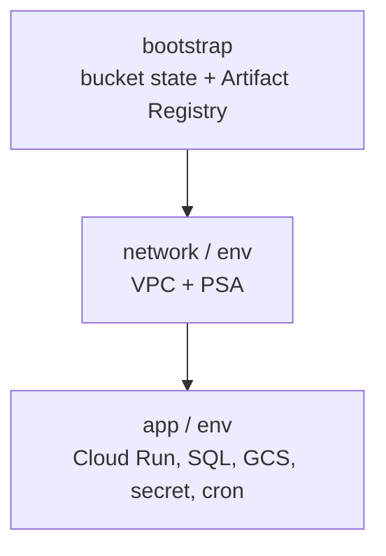

# Hạ tầng GCP DriveeLink

Tài liệu này mô tả cách DriveeLink chạy trên Google Cloud và thứ tự triển khai. Bản tiếng Anh và tiếng Nhật sẽ thêm sau khi bản này được chốt.

Repo triển khai: [TeckVeho/drivee-link-2](https://github.com/TeckVeho/drivee-link-2) (nhánh `develop`).

| Nội dung | Đường dẫn trong repo |
|----------|----------------------|
| Bố cục và lệnh nhanh | [`google_cloud/README.md`](https://github.com/TeckVeho/drivee-link-2/blob/develop/google_cloud/README.md) |
| Terraform | [`google_cloud/terraform/README.md`](https://github.com/TeckVeho/drivee-link-2/blob/develop/google_cloud/terraform/README.md) |
| Topology SQL | [`google_cloud/terraform/SQL_TOPOLOGY.md`](https://github.com/TeckVeho/drivee-link-2/blob/develop/google_cloud/terraform/SQL_TOPOLOGY.md) |
| Ghi chú deploy trong repo | [`google_cloud/DEPLOY_GUIDE.md`](https://github.com/TeckVeho/drivee-link-2/blob/develop/google_cloud/DEPLOY_GUIDE.md) |

## Mục lục

1. [Kiến trúc](#kiến-trúc)
2. [Công cụ và quyền](#công-cụ-và-quyền)
3. [Tạo project](#tạo-project)
4. [Đăng nhập máy local](#đăng-nhập-máy-local)
5. [Thứ tự apply](#thứ-tự-apply)
6. [terraform.tfvars](#terraformtfvars)
7. [Lệnh Terragrunt](#lệnh-terragrunt)
8. [Sau khi apply](#sau-khi-apply)
9. [CI/CD](#cicd)
10. [Sự cố thường gặp](#sự-cố-thường-gặp)
11. [Checklist](#checklist)

## Kiến trúc

Cả ba môi trường nằm trong **một project** `dx-driveelink`, region `asia-northeast1`. Dev, stg và prod tách nhau bằng `env_suffix` và bằng prefix state Terraform. Terraform không tạo project GCP.

| Stack | Việc làm |
|-------|----------|
| `bootstrap` | Bucket state `dx-driveelink-terraform-state`, Artifact Registry `driveelink-docker`, vòng đời source Cloud Build |
| `network/{env}` | VPC và Private Service Access. CIDR mỗi môi trường không được trùng |
| `app/{env}` | Cloud Run (API, web, job migrate / queue / pdf), gắn Cloud SQL, GCS, Secret Manager, Cloud Scheduler |



| Đơn vị Terragrunt | State |
|-------------------|-------|
| `google_cloud/terraform/live/bootstrap` | Local, trong thư mục bootstrap |
| `google_cloud/terraform/live/{env}/network` | `gs://dx-driveelink-terraform-state`, prefix `network/{env}` |
| `google_cloud/terraform/live/{env}/app` | Cùng bucket, prefix `app/{env}` |

Luồng sau khi hạ tầng đã có:

```text
Cloud Build → Artifact Registry (driveelink-docker) → Cloud Run → Cloud SQL (private IP, Direct VPC egress)
```

### Cloud SQL

| Môi trường | Instance | Database | User | Ai sở hữu instance |
|------------|----------|----------|------|--------------------|
| dev | `gcp-dev-sql-hub:asia-northeast1:dev-sql-hub` | `dx_driveelink_dev` | `driveelink_dev` | Project hub. Stack này chỉ gắn vào |
| stg | `dx-driveelink:asia-northeast1:dx-driveelink-prod` | `dx_driveelink_stg` | `driveelink_stg` | Stack prod. Stg tạo database và user của mình |
| prod | `dx-driveelink-prod` | `dx_driveelink_prod` | `driveelink` | Stack prod |

Cloud Run stg dùng **VPC của prod**. Private IP không đi xuyên qua VPC khác. Cloud Run dev dùng Shared VPC của hub (`vpc_network_override` và `vpc_subnetwork_override`).

`enable_sql_night_weekend_schedule` để `false` trên cả ba môi trường. Check trong `modules/app_compose/checks.tf` từ chối lịch tắt khi stack này không sở hữu instance. Bật lịch trên instance dùng chung sẽ tắt luôn production.

### Tên mặc định

| Hạng mục | Giá trị |
|----------|---------|
| Project | `dx-driveelink` |
| Bucket state | `dx-driveelink-terraform-state` |
| Artifact Registry | `asia-northeast1-docker.pkg.dev/dx-driveelink/driveelink-docker` |
| Cloud Run | `driveelink-api-{env}`, `driveelink-web-{env}` |
| Job migrate / queue / pdf | `driveelink-migrate-{env}`, `driveelink-queue-{env}`, `driveelink-pdf-{env}` |
| VPC | `driveelink-vpc-{env}`, subnet `driveelink-connector-{env}` |

Domain mapping của Cloud Run:

| Môi trường | API | Web |
|------------|-----|-----|
| dev | `driveelink-api.vw-dev.com` | `driveelink.vw-dev.com` |
| stg | `v2-stage-api.driveelink.co.jp` | `v2-stage.driveelink.co.jp` |
| prod | `v2-api.driveelink.co.jp` | `v2.driveelink.co.jp` |

## Công cụ và quyền

| Công cụ | Ghi chú |
|---------|---------|
| [Terraform](https://developer.hashicorp.com/terraform/downloads) | `>= 1.5` |
| [Terragrunt](https://terragrunt.gruntwork.io/docs/getting-started/install/) | Sắp `network` trước `app` và ghi backend GCS |
| [Google Cloud SDK](https://cloud.google.com/sdk/docs/install) | `gcloud` |

Tài khoản apply lần đầu trên `dx-driveelink` cần tạo bucket state và Artifact Registry, rồi Cloud Run, Cloud SQL, VPC, Secret Manager và IAM. Apply production đi qua review.

## Tạo project

1. [Google Cloud Console](https://console.cloud.google.com/) → **Create Project**.
2. Project ID: `dx-driveelink`. Khớp `project_id` trong tfvars và `google_cloud/scripts/load-env.sh`.
3. Gắn billing.

Service account Cloud Build (quyền ghi Artifact Registry, khai báo trong tfvars bootstrap):

```bash
gcloud projects describe dx-driveelink --format='value(projectNumber)'
# serviceAccount:NUMBER@cloudbuild.gserviceaccount.com
```

Mẫu: [`environments/bootstrap/terraform.tfvars.example`](https://github.com/TeckVeho/drivee-link-2/blob/develop/google_cloud/terraform/environments/bootstrap/terraform.tfvars.example).

Mỗi stack app có thể ghi label `tier` của project từ `resource_tier`. Ba môi trường dùng chung một project, lần apply sau ghi đè lần trước. Ví dụ hiện tại để `tier3` ở cả ba môi trường.

Import lần đầu, mỗi state app sẽ apply:

```bash
cd google_cloud/terraform/live/dev/app
terragrunt import 'module.app_compose.module.iam.google_project.wiki_labels' dx-driveelink
```

Lặp lại cho `stg` và `prod` nếu các state đó cũng quản lý project.

## Đăng nhập máy local

Provider Google dùng Application Default Credentials. Đăng nhập CLI và ADC là hai bước riêng.

```bash
gcloud auth login
gcloud auth application-default login
gcloud config set project dx-driveelink
gcloud auth application-default print-access-token >/dev/null && echo "ADC OK"
```

Terraform lấy `project_id` từ `terraform.tfvars`. `gcloud config` chỉ ảnh hưởng lệnh `gcloud` tay. Plan báo lỗi credential thì chạy lại `gcloud auth application-default login`.

Impersonate service account khi đã có `roles/iam.serviceAccountTokenCreator`:

```bash
export GOOGLE_IMPERSONATE_SERVICE_ACCOUNT=terraform@dx-driveelink.iam.gserviceaccount.com
gcloud auth application-default login --impersonate-service-account="$GOOGLE_IMPERSONATE_SERVICE_ACCOUNT"
```

## Thứ tự apply

| Bước | Stack | Phụ thuộc |
|------|-------|-----------|
| 1 | `live/bootstrap` | Project `dx-driveelink` đã tồn tại |
| 2 | `live/prod/network` rồi `live/prod/app` | Bucket bootstrap. Prod sở hữu instance SQL dùng chung và VPC mà stg dùng |
| 3 | `live/stg/app` | State network prod và instance SQL prod. Stg chỉ gắn vào |
| 4 | `live/dev/app` | Shared VPC của hub đã gắn. `live/dev/network` là tùy chọn khi `vpc_*_override` trỏ vào hub |
| 5 | Cloud Build | Artifact Registry và stack app đã có |

`enable_cloud_sql = true` cần đúng VPC mà môi trường đó dùng:

- prod: `network_remote_state_prefix = "network/prod"`
- stg: `network_remote_state_prefix = "network/prod"`
- dev: `vpc_network_override` / `vpc_subnetwork_override` vào `gcp-dev-sql-hub`

## terraform.tfvars

`terraform.tfvars` bị gitignore. Copy từ file example rồi sửa.

```bash
cp google_cloud/terraform/environments/bootstrap/terraform.tfvars.example \
   google_cloud/terraform/environments/bootstrap/terraform.tfvars
cp google_cloud/terraform/environments/prod/network/terraform.tfvars.example \
   google_cloud/terraform/environments/prod/network/terraform.tfvars
cp google_cloud/terraform/environments/prod/app/terraform.tfvars.example \
   google_cloud/terraform/environments/prod/app/terraform.tfvars
```

Dev và stg cùng mẫu, trong `google_cloud/terraform/environments/{env}/`.

### Bootstrap

| Biến | Giá trị |
|------|---------|
| `project_id` | `dx-driveelink` |
| `state_bucket_name` | `dx-driveelink-terraform-state` |
| `artifact_repo_id` | `driveelink-docker` |
| `additional_artifact_registry_writer_members` | Service account Cloud Build được push image |

### Network

`project_id` là `dx-driveelink`. `env_suffix` là `dev`, `stg` hoặc `prod`. `connector_subnet_cidr` và `private_service_peering_cidr` khác nhau theo môi trường. Mặc định trong module network: dev `10.8.0.0/24` và PSA `10.247.0.0`, stg `10.9.0.0/24` và `10.248.0.0`, prod `10.10.0.0/24` và `10.249.0.0`.

### App

Ví dụ:

- [dev](https://github.com/TeckVeho/drivee-link-2/blob/develop/google_cloud/terraform/environments/dev/app/terraform.tfvars.example)
- [stg](https://github.com/TeckVeho/drivee-link-2/blob/develop/google_cloud/terraform/environments/stg/app/terraform.tfvars.example)
- [prod](https://github.com/TeckVeho/drivee-link-2/blob/develop/google_cloud/terraform/environments/prod/app/terraform.tfvars.example)

Image:

```text
asia-northeast1-docker.pkg.dev/dx-driveelink/driveelink-docker/driveelink-api:{dev|stg|prod}
asia-northeast1-docker.pkg.dev/dx-driveelink/driveelink-docker/driveelink-web:{dev|stg|prod}
```

Cấu hình không bí mật để trong `env_vars` (`MAIL_FROM_ADDRESS`, `MAIL_FROM_NAME`). Giá trị bí mật nằm ở Secret Manager.

### Cờ Cloud SQL

| Biến | dev | stg | prod |
|------|-----|-----|------|
| `cloud_sql_manage_instance` | `false` | `false` | `true` |
| `cloud_sql_manage_database` | `true` | `true` | `true` |
| `enable_sql_night_weekend_schedule` | `false` | `false` | `false` |
| `sql_deletion_protection` | không có instance local | không có instance local | `true` |
| `sql_backup_enabled` | không áp dụng | không áp dụng | module ép `true` khi `env_suffix = "prod"` |
| `sql_backup_start_time` | — | — | `17:00` UTC. Plan prod lỗi nếu đổi giá trị này |
| `sql_point_in_time_recovery_enabled` | `false` | `false` | `false` trong example hiện tại |

Backup prod và cửa sổ `17:00` được ép trong [`modules/app_compose/data.tf`](https://github.com/TeckVeho/drivee-link-2/blob/develop/google_cloud/terraform/modules/app_compose/data.tf) và [`checks.tf`](https://github.com/TeckVeho/drivee-link-2/blob/develop/google_cloud/terraform/modules/app_compose/checks.tf). Point-in-time recovery tắt cho đến khi bật `sql_point_in_time_recovery_enabled`. Module Cloud SQL cũng đặt `deletion_protection_enabled` khi prod tạo instance.

### Bí mật

Mọi API key, mật khẩu và chuỗi kết nối của Cloud Run nằm trong Secret Manager trên `dx-driveelink`. Không ghi giá trị bí mật vào tfvars, `env_vars`, git, hay substitution của Cloud Build.

| Secret | Ai ghi giá trị | Cloud Run nhận thế nào |
|--------|----------------|------------------------|
| `driveelink-database-url-{env}` | Terraform, khi `cloud_sql_manage_database = true` | Mount `db.env` lên API và các job migrate, queue, pdf |
| `driveelink-app-secrets-{env}` | Vận hành, qua script bên dưới | Mount `/secrets/app.env` khi có `app_secrets_bundle_secret_id` |

Khóa trong bundle (chỉ phần nhạy cảm):

```env
JWT_SECRET=...
OPENAI_API_KEY=...
AWS_SES_ACCESS_KEY_ID=...
AWS_SES_SECRET_ACCESS_KEY=...
```

`DATABASE_URL` không nằm trong bundle. `MAIL_FROM_ADDRESS` và `MAIL_FROM_NAME` ở `env_vars`.

```bash
bash google_cloud/scripts/gcp/create-app-secrets-bundle.sh dev \
  --project dx-driveelink \
  --data-file /path/to/app-secrets.dev.env

bash google_cloud/scripts/gcp/migrate-app-secrets-to-bundle.sh dev
```

Xoay khóa bằng cách thêm version. Mount dùng `latest`, không cần apply Terraform:

```bash
gcloud secrets versions add driveelink-app-secrets-dev \
  --project=dx-driveelink \
  --data-file=/path/to/app-secrets.dev.env
```

Khai báo trong tfvars:

```hcl
app_secrets_bundle_secret_id = "driveelink-app-secrets-dev"
api_secret_env_from_sm       = []
```

Service account runtime của Cloud Run nhận `roles/secretmanager.secretAccessor` từ [`modules/secrets`](https://github.com/TeckVeho/drivee-link-2/blob/develop/google_cloud/terraform/modules/secrets).

### Scheduler

Cloud Scheduler gọi API bằng OIDC. Service account: `driveelink-cron-api-{env}` (giới hạn 30 ký tự). Module: [`modules/app_cron`](https://github.com/TeckVeho/drivee-link-2/blob/develop/google_cloud/terraform/modules/app_cron).

| Cờ | Job | Cron mặc định (`Asia/Tokyo`) | Endpoint |
|----|-----|------------------------------|----------|
| `enable_hr_visa_expire_scheduler` | `driveelink2-hr-visa-expire-reminder-{env}` | `0 10 1 * *` | `POST /api/scheduler/hr-visa-expire-reminder` |
| `enable_hr_recalc_scheduler` | `driveelink2-hr-recalc-{env}` | `0 9 * * *` | `POST /api/scheduler/recalculate` |
| `enable_hr_status_yearly_snapshot_scheduler` | `driveelink2-hr-status-yearly-snapshot-{env}` | dev/stg `0 9 1 1 *`, prod `0 1 1 1 *` | `POST /api/scheduler/freeze-hr-status-yearly-snapshot` |

Example app hiện tại bật cả ba job trên dev, stg và prod.

## Lệnh Terragrunt

Điểm vào: [`google_cloud/terraform/live`](https://github.com/TeckVeho/drivee-link-2/blob/develop/google_cloud/terraform/live/README.md).

```bash
cd google_cloud/terraform/live/bootstrap
terragrunt init
terragrunt plan
terragrunt apply

cd ../prod/network
terragrunt init -reconfigure
terragrunt apply

cd ../app
terragrunt apply
```

Sau đó `live/stg/app` và `live/dev/app`.

| Lệnh | Tác dụng |
|------|----------|
| `init` / `init -reconfigure` | Tải provider và backend GCS. Dùng `-reconfigure` khi đổi bucket hoặc prefix |
| `plan` | Chỉ xem diff |
| `apply` | Đổi GCP và state |
| `output` | URL, connection name, tên job migrate |
| `import` | Nhận resource đã có (label project, domain mapping, scheduler) |

`run-all plan` trong `live/` xem trước mọi unit. Cache nằm ở `live/**/.terragrunt-cache/` và bị gitignore.

## Sau khi apply

### Image

```bash
gcloud auth configure-docker asia-northeast1-docker.pkg.dev
gcloud builds submit --project=dx-driveelink \
  --config=google_cloud/cloudbuild/cloudbuild.dev.yaml
```

Stg và prod: `cloudbuild.stg.yaml`, `cloudbuild.prod.yaml`. Chỉ API hoặc chỉ web: `cloudbuild.{env}.api.yaml`, `cloudbuild.{env}.web.yaml`.

Cloud Build cập nhật image của service và job, rồi chạy `driveelink-migrate-{env}` trừ khi `_SKIP_MIGRATE=true`. Cập nhật image job queue và pdf nằm ở `google_cloud/scripts/gcp/deploy-queue-cloud-run-job.sh` và `deploy-pdf-cloud-run-job.sh`.

### Job migrate

```bash
export PROJECT_ID=dx-driveelink
export MIGRATE_JOB_NAME=driveelink-migrate-dev
bash google_cloud/scripts/run-migrate-job.sh
```

Hoặc từ stack app: `terragrunt output -raw cloud_run_migrate_job_name`.

### Domain và URL public

```bash
cd google_cloud/terraform/live/dev/app
terragrunt output
bash google_cloud/scripts/gcp/map-dev-domain-mappings.sh --skip-terraform
```

Stg: `map-stg-domain-mappings.sh`. Prod: `map-prod-domain-mappings.sh`. `api_custom_domain` và `web_custom_domain` trong tfvars đặt `API_URL`, `FRONTEND_URL`, `CORS_ORIGINS` và `NEXT_PUBLIC_*` của web. Sau khi map bằng `gcloud`, import mapping vào state. Địa chỉ import nằm trong [`google_cloud/README.md`](https://github.com/TeckVeho/drivee-link-2/blob/develop/google_cloud/README.md).

## CI/CD

| Thành phần | Vị trí |
|------------|--------|
| Workflow deploy | [`.github/workflows/cd-gcp-drivee.yml`](https://github.com/TeckVeho/drivee-link-2/blob/develop/.github/workflows/cd-gcp-drivee.yml) |
| Workload Identity Federation | [`google_cloud/cloudbuild/GITHUB_ACTIONS_WIF.md`](https://github.com/TeckVeho/drivee-link-2/blob/develop/google_cloud/cloudbuild/GITHUB_ACTIONS_WIF.md) |
| Cấu hình Cloud Build | [`google_cloud/cloudbuild/README.md`](https://github.com/TeckVeho/drivee-link-2/blob/develop/google_cloud/cloudbuild/README.md) |

Workflow chạy khi push lên `develop`, `staging` và `production` nếu đổi `backend-express/**`, `frontend/**` hoặc `google_cloud/**`. Tên GitHub Environment trùng tên nhánh. Auth dùng `GCP_WORKLOAD_IDENTITY_PROVIDER` và `GCP_SERVICE_ACCOUNT`, không để JSON key trên runner.

`_CLOUDSQL_INSTANCE` trong YAML Cloud Build phải khớp instance đang chạy (`dev-sql-hub` hoặc `dx-driveelink-prod`). Substitution cũ sẽ ghi đè phần gắn Cloud SQL trên service.

## Sự cố thường gặp

| Triệu chứng | Cách xử lý |
|-------------|------------|
| Plan báo `403` hoặc không thấy resource | Làm mới ADC. `project_id` phải là `dx-driveelink` và tài khoản có IAM trên project đó |
| App plan không đọc được state network | Apply đúng stack network môi trường đó dùng. Stg đọc `network/prod`, không đọc `network/stg` |
| Check `enable_sql_night_weekend_schedule` thất bại | Để `false` trên instance hub và instance dùng chung |
| Plan prod lỗi vì giờ backup | Bỏ `sql_backup_start_time` hoặc đặt `17:00` |
| Cloud Run không thấy image | Build và push vào `driveelink-docker` trước |
| API thoát lúc khởi động | Bundle `driveelink-app-secrets-{env}` có `JWT_SECRET`. Secret `driveelink-database-url-{env}` đã tồn tại. Runtime SA có `secretAccessor` |
| Không đọc được secret | Apply lại stack app sau khi đặt `app_secrets_bundle_secret_id` |
| Thiếu job migrate hoặc queue | `terragrunt apply` stack app trước Cloud Build. Build chỉ cảnh báo và bỏ qua job chưa có |
| Khóa state | Đợi apply kia xong. `force-unlock` chỉ khi không còn tiến trình nào ghi state |

## Checklist

**Môi trường đầu tiên**

- [ ] Project `dx-driveelink` đã có và đã gắn billing
- [ ] `terragrunt apply` bootstrap, rồi network môi trường đó dùng, rồi `app`
- [ ] Service account Cloud Build push được vào `driveelink-docker`
- [ ] `driveelink-database-url-{env}` có sau khi apply app
- [ ] Đã tạo bundle `driveelink-app-secrets-{env}`, đặt `app_secrets_bundle_secret_id`, apply lại app
- [ ] Đã build image, job migrate chạy xong, API trả health
- [ ] `enable_sql_night_weekend_schedule = false`

**Production**

- [ ] `live/prod/network` apply trước `live/prod/app`
- [ ] `sql_deletion_protection = true`
- [ ] Backup bật (module ép điều này khi `env_suffix = prod`) và giờ bắt đầu `17:00` UTC
- [ ] Lịch tắt SQL đêm và cuối tuần đang tắt
- [ ] Stg vẫn dùng user `driveelink_stg` và database `dx_driveelink_stg` trên cùng instance
- [ ] Apply đã được review trước khi chạy
